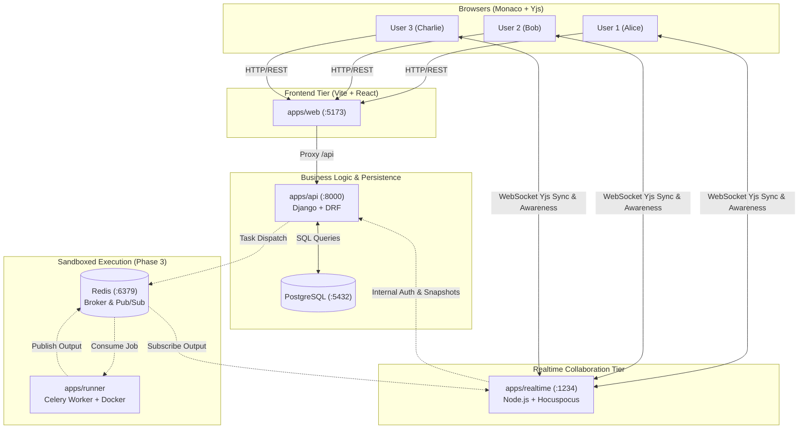

# CodeSync

A real-time collaborative code editor with sandboxed execution. Multiple users edit the same code file simultaneously with live cursors and selections, then execute the code in an isolated container sandbox with real-time streamed output.

---

## Architecture



---

## Features

### Phase 1: Collaboration Core (Complete)
- **Real-time Collaborative Editing**: Conflict-free text synchronization via Yjs CRDT and Monaco editor bindings (`y-monaco`).
- **Live Remote Cursors & Selections**: Peer awareness with deterministic user color assignments and remote cursor name tags.
- **Synchronized Language Selector**: Multi-language support (Python, JavaScript, C++) with instant CRDT map synchronization.
- **Room Management**: Create rooms and share unique link slugs via Django REST API.
- **Automated Convergence Testing**: Deterministic multi-client Yjs suite testing concurrent out-of-order edits.

### Phase 2: Auth, Permissions, Persistence & Presence (Complete)
- **JWT Authentication**: Register, login, refresh, logout with token blacklisting and user profile endpoints.
- **Role-Based Access Control**: Owner, editor, and viewer roles enforced on both REST API and WebSocket connection.
- **Read-Only Share Links**: Tokenized guest links allowing view-only access without an account.
- **Server-Side Write Rejection**: Two-layer enforcement (connection-level `readOnly` + binary frame inspection) dropping unauthorized document updates.
- **Debounced Yjs State Persistence**: Automatic 3-second debounced binary snapshots saved to PostgreSQL with 1 MB document size limits.

### Phase 3: Sandboxed Code Execution (Complete)
- **Multi-Language Sandboxed Execution**: Secure Python, JavaScript, and C++ execution in disposable Alpine Docker containers.
- **Rigorous Container Containment**: Complete network isolation (`network_mode="none"`), read-only rootfs (`read_only=True`), RAM limit (128MB), process limit (`pids_limit=64`), CPU limit (0.5 cores), non-root user (`10001:10001`), and dropped Linux capabilities (`cap_drop=["ALL"]`).
- **Real-Time Streamed Terminal Output**: Celery runner streams stdout/stderr chunks live over Redis pub/sub (`room:<slug>:runs`) and Hocuspocus stateless messages to room clients.
- **Interactive Terminal Panel**: Collapsible drawer with exit codes, wall-clock duration, auto-scroll, ANSI formatting, and `Ctrl+Enter` execution shortcut.
- **Concurrency Locking & Rate Limiting**: Per-room mutex lock (`409 Conflict`) preventing race conditions, 6 runs/min per-user rate limit, and viewer role rejection (`403 Forbidden`).
- **Adversarial Attack Test Suite**: 8 automated security tests verifying containment against infinite loops, memory bombs, fork bombs, network probes, rootfs writes, and secret leaks.
- **Stale Container Reaper**: Background daemon sweeping orphaned sandbox containers older than 30s.

### Upcoming Phases
- **Phase 4**: Multi-instance horizontal scaling, load balancing, and benchmarks.
- **Phase 5**: Polish, themes, keyboard shortcuts, and AI error analysis.

---

## Quick Start (Local Development)

### Prerequisites
- Docker & Docker Compose
- Node.js 20+ (with `pnpm`)
- Python 3.12+

### 1. Setup Environment
```bash
cp .env.example .env
```

### 2. Start Infrastructure
```bash
make dev-infra
# Starts PostgreSQL (5432) and Redis (6379)
```

### 3. Build Sandbox Images
```bash
docker build -t codesync-sandbox-python:latest docker/sandbox-python
docker build -t codesync-sandbox-javascript:latest docker/sandbox-javascript
docker build -t codesync-sandbox-cpp:latest docker/sandbox-cpp
```

### 4. Run Services

**Terminal 1 (Django API):**
```bash
cd apps/api
pip install -r requirements.txt
python manage.py migrate
python manage.py runserver 0.0.0.0:8000
```

**Terminal 2 (Realtime Collaboration Service):**
```bash
cd apps/realtime
pnpm install
pnpm dev
# Listens on ws://localhost:1234
```

**Terminal 3 (Execution Runner Worker):**
```bash
cd apps/runner
pip install -r requirements.txt
celery -A runner worker -Q runner --loglevel=info
```

**Terminal 4 (Vite Web App):**
```bash
cd apps/web
pnpm install
pnpm dev
# Opens at http://localhost:5173
```

---

## Testing

```bash
# Run realtime convergence tests (Vitest)
cd apps/realtime && pnpm test

# Run API test suite (pytest)
cd apps/api && pytest

# Run Runner adversarial security test suite (pytest)
cd apps/runner && pytest tests/test_adversarial.py -v
```

---

## Key Design Decisions
- **CRDT (Yjs) over OT**: Strong eventual consistency without central transform coordinator; robust offline/reconnection merge.
- **Stateless Realtime Tier**: Decoupled Node.js Hocuspocus service handles WebSocket broadcast with minimal memory overhead while Django owns business logic and database models.
- *Read the full design rationale in [docs/DESIGN.md](docs/DESIGN.md).*
