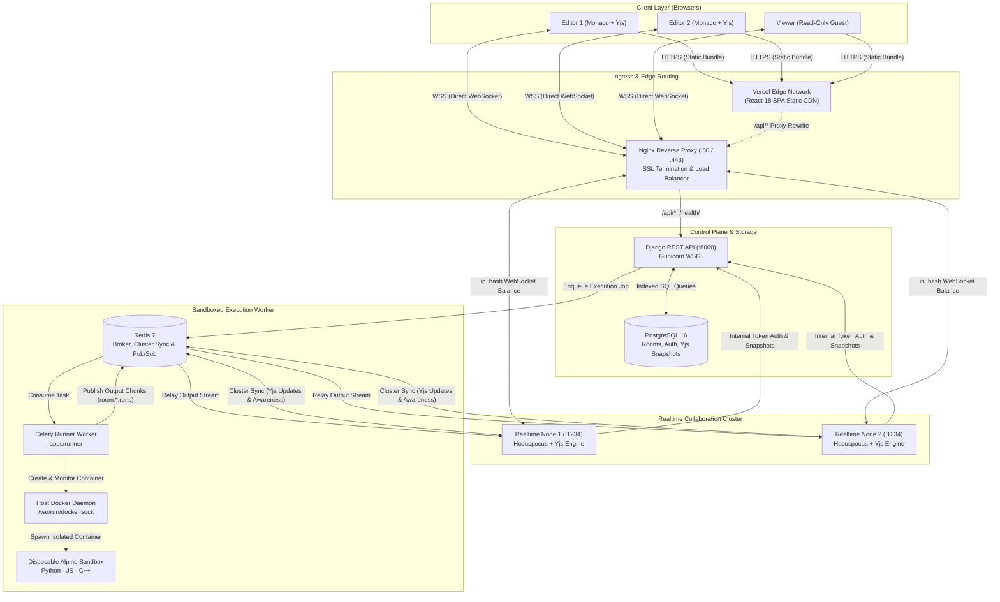

# CodeSync

A real-time collaborative code editor with conflict-free Yjs CRDT synchronization and secure sandboxed execution of untrusted code inside isolated, resource-constrained container environments.

[](https://github.com/ZeroxxG/codesync/actions/workflows/ci.yml)


[Live Demo](https://codesyncapp.duckdns.org) · [Demo Video](<DEMO VIDEO URL>) · [Architecture](docs/DESIGN.md) · [Security](docs/SECURITY.md) · [Benchmarks](docs/BENCHMARKS.md) · [Deployment](docs/DEPLOYMENT.md)

---

## Overview


*Two browser sessions editing Python code with live remote cursors, followed by sandboxed execution streaming stdout/stderr back into the terminal drawer.*

> **Live Demo**: [https://codesyncapp.duckdns.org](https://codesyncapp.duckdns.org)  
> **Demo Access**: Instant anonymous room creation or guest join — no login required. Optional user registration and login available on the home page.

---

## Why This Project Is Interesting

- **Conflict-Free Convergence Without Central Rebase**: Built on Yjs Conflict-Free Replicated Data Types (CRDTs). Edits merge deterministically (`Y.applyUpdate`) across high-latency or temporarily disconnected clients without a centralized Operational Transformation (OT) rebase server.
- **Defense-in-Depth Container Sandboxing**: Untrusted Python, Node.js, and C++ code executes in disposable Alpine containers with zero network access (`network_mode="none"`), immutable root filesystems (`read_only=True`), dropped Linux capabilities (`cap_drop=["ALL"]`), unprivileged execution (`10001:10001`), and hard limits on memory (128 MB), CPU (0.5 cores), processes (64 PIDs), and runtime (10s wall timeout).
- **Two-Layer Server-Side Permission Enforcement**: Read-only guest viewers are restricted both at the WebSocket connection level (`readOnly = true`) and via deep binary frame inspection that discards unauthorized document updates before they reach the server's in-memory `Y.Doc`.
- **Horizontal Multi-Instance Clustering**: A stateless Node.js Hocuspocus tier synchronized over a Redis Pub/Sub cluster backplane allows independent scaling of WebSocket connection capacity behind an Nginx load balancer (`ip_hash`) with a median cross-instance sync latency of 29.03 ms.

---

## Key Features

| Capability | Technical Implementation | Highlights |
|---|---|---|
| **Collaborative Editor** | Monaco Editor + Yjs (`y-monaco`) | Conflict-free text sync with sub-millisecond local keystroke insertion and zero editor flicker. |
| **Peer Presence & Cursors** | Yjs Awareness Protocol | Remote cursor names, selection tracking, and deterministic user color hashing. |
| **Sandboxed Execution** | Celery + Docker Engine SDK | Isolated Alpine environments for Python 3.12, Node.js 20, and C++ (GCC 13). |
| **Streamed Execution Output** | Redis Pub/Sub + Hocuspocus | Live stdout/stderr chunk streaming to room clients via stateless WebSocket messages. |
| **Role-Based Access Control** | Django REST Framework + SimpleJWT | Owner, Editor, and Viewer permissions with tokenized read-only guest invite links. |
| **Document Persistence** | PostgreSQL + Django ORM | 3-second debounced binary snapshot persistence to `BinaryField` with 1 MB document caps. |
| **AI Error Diagnosis** | Gemini API + Heuristic Fallback | Automatic root-cause analysis for runtime/compiler errors, backed by local heuristic parsing and 5 req/10 min rate limits. |
| **Interface Polish & DX** | React Context + Tailwind CSS | Zero-rebind theme toggle (`vs-dark` / `vs`), execution history modal, and keyboard shortcuts (`?`, `Ctrl+Enter`, `Ctrl+S`). |

---

## Architecture



### End-to-End Request Flows

#### 1. Collaborative Edit Synchronization
1. When a user types in Monaco, `y-monaco` captures the event and mutates the local `Y.Text` CRDT structure.
2. Yjs generates a compact binary diff (`UpdateV1`) and transmits it over WebSocket to the assigned Hocuspocus instance.
3. The realtime server verifies the client's role. If the client is a viewer, the packet is discarded immediately. If the client has write access, the server applies the update to its in-memory `Y.Doc`.
4. The server schedules a 3-second debounced snapshot save to PostgreSQL via Django's internal API (`PUT /internal/rooms/<slug>/snapshot/`) and publishes the update to Redis (`codesync:yjs:*`).
5. Peer Hocuspocus instances receive the pub/sub event and relay it to their connected clients, who apply it locally with guaranteed mathematical convergence.

#### 2. Sandboxed Code Execution
1. An editor clicks **Run** (`Ctrl+Enter`), dispatching `POST /api/rooms/<slug>/runs/` to the Django API.
2. Django verifies authentication/role, checks rate limits (6 runs/min per user), and acquires a Redis mutex lock (`room:<slug>:running_lock`, 15s TTL) to prevent overlapping executions in the same room (`409 Conflict`).
3. Django persists a `Run` record with status `QUEUED` and enqueues a Celery task on the `runner` queue.
4. The Celery worker pulls the task, writes the submitted code to a temporary directory, and calls the Docker Engine SDK to create an isolated Alpine container (`network_mode="none"`, `read_only=True`, 128 MB RAM, 0.5 CPU, 10s timeout).
5. As the code runs, the worker streams stdout/stderr output chunks to Redis Pub/Sub (`room:<slug>:runs`), which Hocuspocus broadcasts to all room clients as stateless WebSocket events.
6. Upon container exit, the runner records exit code, wall-clock execution time, and output, updates the database via an authenticated internal callback (`PUT /internal/runs/<id>/`), releases the Redis mutex lock, and removes the container.

---

## Tech Stack

| Layer | Technology | Version | Why This Choice |
|---|---|---|---|
| **Frontend UI** | React | 18.3 | Component model for synchronized room states, modals, and hot UI updates. |
| | TypeScript | 5.5 | Type safety across WebSocket payloads and REST data contracts. |
| | Monaco Editor | 0.52 | VS Code editor core with rich syntax highlighting and language markers. |
| | Tailwind CSS | 3.4 | Utility styling with dark theme support and zero runtime CSS overhead. |
| **Realtime Sync** | Hocuspocus | 2.15 | Headless Node.js WebSocket server tailored for Yjs CRDT synchronization. |
| | Yjs & y-monaco | 13.6 / 0.1 | Conflict-free replicated data types with $O(1)$ amortized local insertions. |
| | Redis Cluster Sync | `@hocuspocus/extension-redis` | Multi-node WebSocket sync via Redis pub/sub backplane. |
| **Backend API** | Django & DRF | 5.1 / 3.15 | Robust ORM, declarative serialization, and built-in database migration tooling. |
| | SimpleJWT | 5.3 | Stateless JWT authentication with refresh rotation and guest tokens. |
| | PostgreSQL | 16 | ACID relational storage for room memberships and binary Yjs document snapshots. |
| | Gunicorn | 23.0 | Multi-worker WSGI HTTP server behind reverse proxy. |
| **Sandbox Runner** | Celery | 5.4 | Distributed asynchronous task queue for execution orchestration. |
| | Docker Engine SDK | Python `docker` | Programmatic container lifecycle management with strict Linux cgroups containment. |
| | Alpine Linux | 3.20 | Minimal attack surface and sub-100MB base images for Python, JS, and C++. |
| **Infrastructure** | Nginx | 1.24 | Edge SSL termination, `ip_hash` WebSocket sticky routing, and API reverse proxying. |
| | Redis | 7.2 | Celery task broker, execution lock mutex, and realtime pub/sub message bus. |
| | Vercel | Edge Network | Global CDN hosting for static frontend SPA with production API rewrites. |
| | Azure VM | Ubuntu 22.04 LTS | Cloud compute hosting Nginx, API, Hocuspocus cluster, and runner worker. |

---

## Security Model

Untrusted code execution introduces severe host risk if uncontained. CodeSync executes user-submitted code in ephemeral Alpine Linux containers created dynamically by the Celery runner with defense-in-depth isolation controls:

### Sandbox Isolation Controls

| Containment Parameter | Configuration | Security Enforcement |
|---|---|---|
| **Network Isolation** | `network_mode="none"` | Drops entire network stack; completely blocks SSRF, botnet dialing, and data exfiltration. |
| **Filesystem Immutability** | `read_only=True` | Root filesystem mounted read-only; blocks binary tampering and persistent rootkits. |
| **Ephemeral Working Dir** | `tmpfs={"/tmp": ...}` | In-memory RAM disk for source files (`size=16m,noexec,nosuid,nodev` for Python/JS; `exec` for C++ compilation); zero host disk persistence. |
| **Unprivileged Execution** | `user="10001:10001"` | Executes as unprivileged `sandbox` user; blocks root escalation within the container. |
| **Capability Stripping** | `cap_drop=["ALL"]` | Drops all Linux capabilities (`CAP_SYS_ADMIN`, `CAP_NET_ADMIN`, `CAP_CHOWN`, etc.). |
| **Privilege Escalation Block** | `security_opt=["no-new-privileges:true"]` | Prevents `setuid` binaries from gaining elevated permissions. |
| **Memory Ceiling** | `mem_limit="128m"`, `memswap_limit="128m"` | Hard cgroup RAM ceiling with zero swap; OOM terminates runaway memory bombs instantly (exit 137). |
| **CPU Throttling** | `nano_cpus=500_000_000` | Limits container to 0.5 CPU core; prevents infinite loops from starving host system resources. |
| **Process Table Cap** | `pids_limit=64` | Process ceiling; prevents fork bombs (`EAGAIN` / `BlockingIOError`). |
| **Execution Timeout** | 10 seconds | Supervisor thread terminates hanging processes and infinite loops. |
| **Output Flood Cap** | 64 KB (`65536` bytes) | Guards against memory and network saturation from stdout infinite spam. |

### Adversarial Attack Verification Suite

A dedicated automated adversarial suite (`apps/runner/tests/test_adversarial.py`) validates container containment against 8 exploit vectors on every test run:

1. **Infinite Loop Timeout**: Verified process termination within 10s and status flagged as `timeout`.
2. **Memory Bomb OOM**: Verified 200 MB allocation triggers kernel OOM termination (exit code 137, status `oom`).
3. **Fork Bomb Process Exhaustion**: Verified process spawning is halted at 64 PIDs (`BlockingIOError`).
4. **Output Flooding Truncation**: Verified 150 KB stdout stream is truncated at 64 KB with notification.
5. **Outbound Network Probing**: Verified TCP socket connections fail immediately with `Network unreachable`.
6. **Read-Only Root Filesystem**: Verified writes to `/etc` or `/usr` fail with `Read-only file system`.
7. **Secret Isolation**: Verified container environment contains no database credentials or Django keys.
8. **Docker Socket Exclusion**: Verified `/var/run/docker.sock` is absent and unreachable from container.

### Containment Boundaries (What This Does Not Protect Against)

While Docker cgroup and capability isolation stops script-level attacks and unauthorized privilege escalation, standard containerization shares the underlying host Linux kernel. It does not protect against:
- **Zero-day Linux kernel privilege escalations** that escape Linux namespace containment.
- **CPU cache timing or speculative execution side-channel attacks** across co-located containers on the same physical host.

For enterprise multi-tenant cloud scale, the recommended hardening path is user-space kernel virtualization (gVisor `runsc`) or hardware-isolated microVMs (AWS Firecracker). See [docs/SECURITY.md](docs/SECURITY.md) for full threat modeling.

---

## Performance & Benchmarks

CodeSync's realtime synchronization and API throughput were empirically measured under concurrent load using the automated benchmark suite in `benchmarks/`.

**Test Setup**: 2 Hocuspocus instances clustered over Redis 7, 5 active rooms, 20 concurrent editors (4 editors/room), 50 cross-instance sync operations.

| Metric | Measured Value | Threshold / Target | Status |
|---|---|---|---|
| **CRDT Cross-Instance Propagation (Min)** | **22.82 ms** | < 50 ms | PASS |
| **CRDT Cross-Instance Propagation (p50)** | **29.03 ms** | < 80 ms | PASS |
| **CRDT Cross-Instance Propagation (p95)** | **160.28 ms** | < 200 ms | PASS |
| **CRDT Cross-Instance Propagation (Max)** | **176.57 ms** | < 300 ms | PASS |
| **CRDT Convergence Throughput** | **82.5 ops/sec** | > 50 ops/sec | PASS |
| **Operation Dropped / Convergence Errors** | **0 (0.0%)** | 0 | PASS |
| **WebSocket Connect & Initial Sync (p50)** | **417.43 ms** | < 1000 ms | PASS |
| **WebSocket Connect & Initial Sync (p95)** | **556.61 ms** | < 1500 ms | PASS |
| **Django API Health Check Throughput** | **26.8 req/sec** | — | PASS |
| **Django API Health Check Latency (p50)** | **225.77 ms** | — | PASS |

> [!NOTE]
> Median cross-instance CRDT sync latency is **29.03 ms**, showing that Redis pub/sub relay introduces negligible overhead. Read the full methodology, load scripts, and raw data in [docs/BENCHMARKS.md](docs/BENCHMARKS.md).

---

## Engineering Highlights

Detailed rationale behind the core technical decisions in CodeSync (drawn from [docs/DESIGN.md](docs/DESIGN.md)):

### 1. CRDTs (Yjs) over Operational Transformation (OT)
OT architectures (e.g. Google Docs) rely on a central coordinator to establish a total ordering of operations and transform incoming concurrent mutations against in-flight buffers. If the coordinator drops packets or partitions, client state diverges. CodeSync adopts Yjs CRDTs because state vectors guarantee mathematical convergence on all peers regardless of network arrival order (`Y.applyUpdate`). Furthermore, Yjs merges sequential character insertions into run-length-encoded item structs, achieving near-string memory overhead (~1-2 bytes per char) and sub-millisecond local updates.

### 2. Dedicated Node.js Realtime Service vs Django Channels
Collaborative typing produces a high frequency of tiny WebSocket frames (keystrokes and cursor coordinates up to 60 Hz). Node.js's asynchronous non-blocking event loop handles thousands of concurrent binary WebSocket connections with minimal per-socket memory (~10–20 KB) and native `ArrayBuffer` performance. Keeping the realtime tier completely stateless and separated from Django ensures that database queries, migrations, or heavy API transactions never block the editor's typing loop.

### 3. Horizontal Clustering via Redis Pub/Sub Backplane
Rather than pinning rooms to specific server processes or relying on complex distributed consensus, CodeSync uses `@hocuspocus/extension-redis` to link independent Hocuspocus nodes. When an update is applied on Node A, it is published to `codesync:yjs:<roomSlug>` over Redis; Node B receives the message and immediately propagates it to its local clients. This architecture demonstrated a median cross-instance propagation latency of 29.03 ms across independent nodes in load testing.

### 4. Defense-in-Depth Server-Side Viewer Protection
Client-side UI disabling (`readOnly: true` in Monaco) is cosmetic and easily bypassed by an attacker transmitting raw Yjs WebSocket update frames. CodeSync enforces viewer protection at two server-side layers: first during the connection handshake (`readOnly = true` attached to socket context), and second via binary message inspection (`beforeHandleMessage`) that discards incoming Yjs sync/update frames from viewers before they can touch the server's in-memory `Y.Doc`.

### 5. Execution Concurrency Mutex and Sandbox Reaper
To prevent resource exhaustion from concurrent execution requests within the same room, the Django API acquires a Redis distributed lock (`room:<slug>:running_lock`, 15-second TTL) before dispatching a run to Celery, rejecting overlapping requests with `409 Conflict`. In addition, an independent reaper daemon (`apps/runner/runner/reaper.py`) continuously queries the host Docker daemon for containers with the `codesync: sandbox` label older than 30 seconds, automatically destroying any orphaned containers caused by worker crashes.

---

## Testing & CI

CodeSync maintains a strict automated test suite verifying correctness, concurrency, and adversarial containment across every service layer.

### Automated Test Suite (51 Tests Total)

| Service Layer | Test Framework | Test Scope | Result |
|---|---|---|---|
| **API (`apps/api`)** | pytest + pytest-django | Room creation, membership RBAC, SimpleJWT auth, invite link tokens, snapshot endpoints, run serialization, and rate limits. | **31 passed** |
| **Realtime (`apps/realtime`)** | Vitest | Yjs document convergence, two-layer viewer edit rejection, snapshot debouncing, health probes, and Redis cluster pub/sub sync. | **9 passed** |
| **Runner (`apps/runner`)** | pytest | Celery task invocation, output chunk streaming, reaper daemon sweeps, and the **8 adversarial security exploits**. | **11 passed** |
| **Web (`apps/web`)** | TypeScript (`tsc`) + Vite | Strict TypeScript typechecking (`--noEmit`) and production static bundle compilation. | **Verified** |

### Continuous Integration Pipeline

GitHub Actions runs on every push and pull request to `main` (`.github/workflows/ci.yml`):
- **`python-test` Job**: Boots ephemeral `postgres:16-alpine` and `redis:7-alpine` service containers, executes database migrations, and runs all 42 pytest tests across the API and execution runner.
- **`node-test` Job**: Boots `redis:7-alpine`, executes pnpm typechecks and test suites for the realtime collaboration engine, and validates the frontend production build.

---

## Quick Start

### Prerequisites
- [Docker Engine](https://docs.docker.com/engine/install/) & [Docker Compose](https://docs.docker.com/compose/)
- [Node.js 20+](https://nodejs.org/) & [pnpm 9+](https://pnpm.io/)
- [Python 3.12+](https://www.python.org/)

### 1. Clone & Preflight Check
```bash
git clone https://github.com/ZeroxxG/codesync.git
cd codesync

# Run diagnostic tool to check Docker, tool versions, and port availability
make doctor
```

### 2. Launch Full Stack (Zero Configuration)
Copy the default environment and boot all services (PostgreSQL, Redis, Django API, Realtime cluster, Runner, Nginx, and Web):
```bash
# Bootstrap .env and start all services
cp .env.example .env     # or run: make setup
make dev                 # or: docker compose --profile full up --build
```
> [!TIP]
> `make dev` automatically builds the language sandbox container images (`codesync-sandbox-python`, `codesync-sandbox-javascript`, `codesync-sandbox-cpp`) and coordinates service health checks on boot.

Open [http://localhost:5173](http://localhost:5173) in your browser.

### 3. Verify With End-to-End Smoke Test
Run the automated smoke test suite to verify health endpoints, guest room creation, dual WebSocket peer synchronization, and sandboxed execution:
```bash
make smoke
```

### Alternative: Hybrid Development Mode (Fast Hot-Reload)
For active local development with instant hot reload:
```bash
# 1. Start PostgreSQL and Redis
make dev-infra

# 2. Run backend migrations and start API (terminal 1)
cd apps/api
python -m venv .venv && source .venv/bin/activate  # on Windows: .venv\Scripts\activate
pip install -r requirements.txt
python manage.py migrate
python manage.py runserver 8000

# 3. Start realtime WebSocket cluster (terminal 2)
cd apps/realtime
pnpm install
pnpm dev

# 4. Start frontend Vite development server (terminal 3)
cd apps/web
pnpm install
pnpm dev
```

### Running Test Suites
```bash
# Run Django API test suite
pytest apps/api/rooms/tests -v

# Run Celery runner & adversarial container security suite
pytest apps/runner/tests -v

# Run Realtime collaboration test suite
pnpm --prefix apps/realtime test

# Validate Web frontend TypeScript types and build
pnpm --prefix apps/web build
```

---

## Troubleshooting

| Problem | Root Cause | Solution |
|---|---|---|
| **Port Conflict (`Bind for 0.0.0.0:5432 failed`)** | Another PostgreSQL, Redis, or Web service is already bound to port 80, 1234, 5173, 5432, 6379, or 8000. | Run `make doctor` to identify the blocked port. Run `docker ps` to see conflicting containers, or stop local background services (`sudo systemctl stop postgresql`). |
| **Docker Daemon Not Running** | The Docker service or Docker Desktop is stopped. | Start Docker Desktop (macOS/Windows) or run `sudo systemctl start docker` (Linux). Verify with `docker info`. |
| **Permission Denied (`/var/run/docker.sock`)** | Current user lacks permissions to interact with the Docker daemon. | Add your user to the Docker group: `sudo usermod -aG docker $USER && newgrp docker`. On Windows WSL2, ensure Docker Desktop WSL integration is enabled. |
| **Slow First Build** | The initial build downloads base Alpine images and compiles Node/Python packages. | Normal on initial clone (~2-3 minutes depending on network). Subsequent starts use Docker's cached layer images and take under 3 seconds. |
| **pnpm Version Mismatch** | Using unpinned pnpm 10+ which restricts lifecycle scripts by default. | CodeSync Dockerfiles pin `pnpm@9.15.9`. For host development, install `npm install -g pnpm@9.15.9`. |

---

## Deployment

CodeSync runs in production across a hybrid cloud topology combining **Vercel** and **Microsoft Azure**:

- **Edge Frontend**: Hosted globally on Vercel's Edge Network, serving the React 18 SPA and proxying `/api/*` REST calls to the Azure backend.
- **Compute & Execution Tier**: Hosted on an Azure Linux VM (`Standard_B2s`, Ubuntu 24.04 LTS) running Docker Compose orchestration for Nginx, Gunicorn/Django API, two clustered Hocuspocus realtime instances, and the Celery execution runner with host Docker daemon access.
- **Persistence & Gateway**: Backed by Azure Database for PostgreSQL Flexible Server, Redis 7 message bus, and an Nginx reverse proxy terminating Let's Encrypt SSL certificates under domain `https://codesyncapp.duckdns.org`.

For step-by-step Azure provisioning scripts, environment configuration, systemd services, and production deployment checklists, see [docs/DEPLOYMENT.md](docs/DEPLOYMENT.md).

---

## Project Structure

<details>
<summary><strong>Click to expand full repository structure</strong></summary>

```
codesync/
├── .github/
│   └── workflows/          # GitHub Actions CI matrix (API, Runner, Realtime, Web)
├── apps/
│   ├── api/                # Django REST API, SimpleJWT auth, room models, Celery dispatcher
│   ├── realtime/           # Node.js Hocuspocus WebSocket server + Yjs engine + Redis extension
│   ├── runner/             # Celery execution worker + Docker SDK sandbox + Reaper daemon
│   └── web/                # React 18 SPA, Monaco Editor, Tailwind CSS, Yjs awareness
├── benchmarks/             # Load test scripts for Yjs cross-instance propagation & API throughput
├── docker/
│   ├── nginx/              # Nginx gateway reverse proxy and load balancing configuration
│   ├── sandbox-cpp/        # Minimal Alpine Dockerfile + runner script for C++ GCC 13
│   ├── sandbox-javascript/ # Minimal Alpine Dockerfile for Node.js 20 execution
│   └── sandbox-python/     # Minimal Alpine Dockerfile for Python 3.12 execution
├── docs/                   # Architectural specs, security threat model, benchmarks, runbooks
│   └── assets/             # Demo media, diagrams, and visual walk-throughs
├── docker-compose.yml      # Local multi-service orchestration (Postgres, Redis, API, Realtime)
├── docker-compose.prod.yml # Production VM deployment configuration
├── Makefile                # Developer task shortcuts (dev-infra, dev, test, lint)
├── LICENSE                 # MIT License specification
└── vercel.json             # Vercel deployment rewrites and edge proxy routing
```

</details>

---

## What I Learned & What I'd Do Next

### Engineering Lessons & Trade-Offs

1. **CRDT History vs Ephemeral Awareness Separation**:
   Monaco cursor events fire up to 60+ times per second during mouse drags. In early testing, routing cursor position updates into the document CRDT structure caused rapid tombstone growth and bloated snapshot sizes. Decoupling cursor presence into an ephemeral Yjs awareness protocol with 30-second TTL heartbeats eliminated document memory bloat while maintaining responsive cursor tracking.

2. **Monaco Theme Rebinding vs WebSocket Reconnection**:
   Switching between dark and light themes dynamically in Monaco initially triggered full editor component remounts, which severed active `y-monaco` bindings and caused brief WebSocket dropouts. Refactoring theme management to mutate Monaco's global theme registry in place preserved both editor model state and active socket connections without visual stutter.

3. **Defense-in-Depth Against Malicious Payloads**:
   Client-side permission toggles (`readOnly: true` in Monaco) are purely visual and offer no security against forged WebSocket packets. True multi-tenant safety required dual-layer server verification: connection context rejection during authentication, coupled with deep binary frame inspection that discards unauthorized Yjs update frames before they reach the server's in-memory `Y.Doc`.

### What I'd Do Next

1. **Hypervisor-Level MicroVM Isolation**:
   Upgrade the execution sandbox from Docker cgroups to user-space kernel virtualization (**gVisor `runsc`**) or lightweight hardware-isolated microVMs (**AWS Firecracker**). This eliminates shared Linux kernel attack vectors and ensures multi-tenant security against kernel zero-day privilege escalations.

2. **Distributed Observability & OpenTelemetry**:
   Implement end-to-end distributed tracing across Django API, Hocuspocus WebSocket nodes, and Celery runner tasks using OpenTelemetry and Prometheus/Grafana to profile live keystroke-to-screen propagation and execution queue times under production loads.

3. **Milestone Version History & Branching**:
   Leverage Yjs state vectors to introduce document revision snapshots with git-like side-by-side diffing and instant one-click rollback directly inside the Monaco editor.

---

## Author & License

### Author
- **GitHub**: [<GITHUB URL>](<GITHUB URL>)
- **LinkedIn**: [<LINKEDIN URL>](<LINKEDIN URL>)
- **Live Demo**: [https://codesyncapp.duckdns.org](https://codesyncapp.duckdns.org)

*Open to engineering discussions, feedback, and software engineering opportunities.*

### License
This project is open-source and licensed under the [MIT License](LICENSE).
