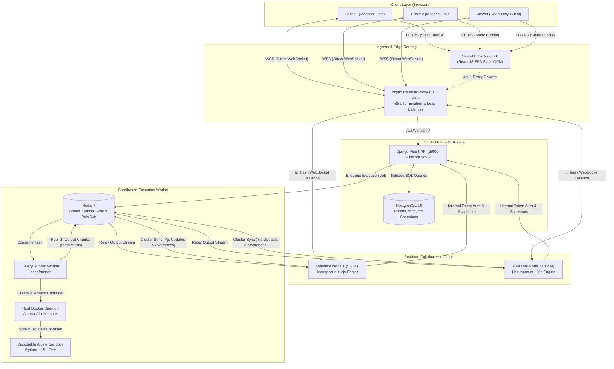

# CodeSync

A real-time collaborative code editor with conflict-free Yjs CRDT synchronization and secure sandboxed execution of untrusted code inside isolated, resource-constrained container environments.

[Live Demo](https://codesyncapp.duckdns.org) · [Architecture](docs/DESIGN.md) · [Security](docs/SECURITY.md) · [Benchmarks](docs/BENCHMARKS.md) · [Deployment](docs/DEPLOYMENT.md)

---

## Overview

*Two browser sessions editing Python code with live remote cursors, followed by sandboxed execution streaming stdout/stderr back into the terminal drawer.*

> **Live Demo**: [https://codesyncapp.duckdns.org](https://codesyncapp.duckdns.org)  
> **Demo Access**: Instant anonymous room creation or guest join — no login required. Optional user registration and login available on the home page.

---

## Why This Project Is Interesting

- **Conflict-Free Convergence Without Central Rebase**: Built on Yjs Conflict-Free Replicated Data Types (CRDTs). Edits merge deterministically (`Y.applyUpdate`) across high-latency or temporarily disconnected clients without a centralized Operational Transformation (OT) rebase server.
- **Defense-in-Depth Container Sandboxing**: Untrusted Python, Node.js, and C++ code executes in disposable Alpine containers with zero network access (`network_mode="none"`), immutable root filesystems (`read_only=True`), dropped Linux capabilities (`cap_drop=["ALL"]`), unprivileged execution (`10001:10001`), and hard limits on memory (128 MB), CPU (0.5 cores), processes (64 PIDs), and runtime (10s wall timeout).
- **Two-Layer Server-Side Permission Enforcement**: Read-only guest viewers are restricted both at the WebSocket connection level (`readOnly = true`) and via deep binary frame inspection that discards unauthorized document updates before they reach the server's in-memory `Y.Doc`.
- **Horizontal Multi-Instance Clustering**: A stateless Node.js Hocuspocus tier synchronized over a Redis Pub/Sub cluster backplane allows independent scaling of WebSocket connection capacity behind an Nginx load balancer (`ip_hash`) with a median cross-instance sync latency of 29.03 ms.

---

## Key Features

| Capability | Technical Implementation | Highlights |
|---|---|---|
| **Collaborative Editor** | Monaco Editor + Yjs (`y-monaco`) | Conflict-free text sync with sub-millisecond local keystroke insertion and zero editor flicker. |
| **Peer Presence & Cursors** | Yjs Awareness Protocol | Remote cursor names, selection tracking, and deterministic user color hashing. |
| **Sandboxed Execution** | Celery + Docker Engine SDK | Isolated Alpine environments for Python 3.12, Node.js 20, and C++ (GCC 13). |
| **Streamed Execution Output** | Redis Pub/Sub + Hocuspocus | Live stdout/stderr chunk streaming to room clients via stateless WebSocket messages. |
| **Role-Based Access Control** | Django REST Framework + SimpleJWT | Owner, Editor, and Viewer permissions with tokenized read-only guest invite links. |
| **Document Persistence** | PostgreSQL + Django ORM | 3-second debounced binary snapshot persistence to `BinaryField` with 1 MB document caps. |
| **AI Error Diagnosis** | Gemini API + Heuristic Fallback | Automatic root-cause analysis for runtime/compiler errors, backed by local heuristic parsing and 5 req/10 min rate limits. |
| **Interface Polish & DX** | React Context + Tailwind CSS | Zero-rebind theme toggle (`vs-dark` / `vs`), execution history modal, and keyboard shortcuts (`?`, `Ctrl+Enter`, `Ctrl+S`). |

---

## Architecture

### End-to-End Request Flows

#### 1. Collaborative Edit Synchronization
1. When a user types in Monaco, `y-monaco` captures the event and mutates the local `Y.Text` CRDT structure.
2. Yjs generates a compact binary diff (`UpdateV1`) and transmits it over WebSocket to the assigned Hocuspocus instance.
3. The realtime server verifies the client's role. If the client is a viewer, the packet is discarded immediately. If the client has write access, the server applies the update to its in-memory `Y.Doc`.
4. The server schedules a 3-second debounced snapshot save to PostgreSQL via Django's internal API (`PUT /internal/rooms/<slug>/snapshot/`) and publishes the update to Redis (`codesync:yjs:*`).
5. Peer Hocuspocus instances receive the pub/sub event and relay it to their connected clients, who apply it locally with guaranteed mathematical convergence.

#### 2. Sandboxed Code Execution
1. An editor clicks **Run** (`Ctrl+Enter`), dispatching `POST /api/rooms/<slug>/runs/` to the Django API.
2. Django verifies authentication/role, checks rate limits (6 runs/min per user), and acquires a Redis mutex lock (`room:<slug>:running_lock`, 15s TTL) to prevent overlapping executions in the same room (`409 Conflict`).
3. Django persists a `Run` record with status `QUEUED` and enqueues a Celery task on the `runner` queue.
4. The Celery worker pulls the task, writes the submitted code to a temporary directory, and calls the Docker Engine SDK to create an isolated Alpine container (`network_mode="none"`, `read_only=True`, 128 MB RAM, 0.5 CPU, 10s timeout).
5. As the code runs, the worker streams stdout/stderr output chunks to Redis Pub/Sub (`room:<slug>:runs`), which Hocuspocus broadcasts to all room clients as stateless WebSocket events.
6. Upon container exit, the runner records exit code, wall-clock execution time, and output, updates the database via an authenticated internal callback (`PUT /internal/runs/<id>/`), releases the Redis mutex lock, and removes the container.

---

## Tech Stack

| Layer | Technology | Version | Why This Choice |
|---|---|---|---|
| **Frontend UI** | React | 18.3 | Component model for synchronized room states, modals, and hot UI updates. |
| | TypeScript | 5.5 | Type safety across WebSocket payloads and REST data contracts. |
| | Monaco Editor | 0.52 | VS Code editor core with rich syntax highlighting and language markers. |
| | Tailwind CSS | 3.4 | Utility styling with dark theme support and zero runtime CSS overhead. |
| **Realtime Sync** | Hocuspocus | 2.15 | Headless Node.js WebSocket server tailored for Yjs CRDT synchronization. |
| | Yjs & y-monaco | 13.6 / 0.1 | Conflict-free replicated data types with $O(1)$ amortized local insertions. |
| | Redis Cluster Sync | `@hocuspocus/extension-redis` | Multi-node WebSocket sync via Redis pub/sub backplane. |
| **Backend API** | Django & DRF | 5.1 / 3.15 | Robust ORM, declarative serialization, and built-in database migration tooling. |
| | SimpleJWT | 5.3 | Stateless JWT authentication with refresh rotation and guest tokens. |
| | PostgreSQL | 16 | ACID relational storage for room memberships and binary Yjs document snapshots. |
| | Gunicorn | 23.0 | Multi-worker WSGI HTTP server behind reverse proxy. |
| **Sandbox Runner** | Celery | 5.4 | Distributed asynchronous task queue for execution orchestration. |
| | Docker Engine SDK | Python `docker` | Programmatic container lifecycle management with strict Linux cgroups containment. |
| | Alpine Linux | 3.20 | Minimal attack surface and sub-100MB base images for Python, JS, and C++. |
| **Infrastructure** | Nginx | 1.24 | Edge SSL termination, `ip_hash` WebSocket sticky routing, and API reverse proxying. |
| | Redis | 7.2 | Celery task broker, execution lock mutex, and realtime pub/sub message bus. |
| | Vercel | Edge Network | Global CDN hosting for static frontend SPA with production API rewrites. |
| | Azure VM | Ubuntu 22.04 LTS | Cloud compute hosting Nginx, API, Hocuspocus cluster, and runner worker. |

---

## Security Model

Untrusted code execution introduces severe host risk if uncontained. CodeSync executes user-submitted code in ephemeral Alpine Linux containers created dynamically by the Celery runner with defense-in-depth isolation controls:

### Sandbox Isolation Controls

| Containment Parameter | Configuration | Security Enforcement |
|---|---|---|
| **Network Isolation** | `network_mode="none"` | Drops entire network stack; completely blocks SSRF, botnet dialing, and data exfiltration. |
| **Filesystem Immutability** | `read_only=True` | Root filesystem mounted read-only; blocks binary tampering and persistent rootkits. |
| **Ephemeral Working Dir** | `tmpfs={"/tmp": ...}` | In-memory RAM disk for source files (`size=16m,noexec,nosuid,nodev` for Python/JS; `exec` for C++ compilation); zero host disk persistence. |
| **Unprivileged Execution** | `user="10001:10001"` | Executes as unprivileged `sandbox` user; blocks root escalation within the container. |
| **Capability Stripping** | `cap_drop=["ALL"]` | Drops all Linux capabilities (`CAP_SYS_ADMIN`, `CAP_NET_ADMIN`, `CAP_CHOWN`, etc.). |
| **Privilege Escalation Block** | `security_opt=["no-new-privileges:true"]` | Prevents `setuid` binaries from gaining elevated permissions. |
| **Memory Ceiling** | `mem_limit="128m"`, `memswap_limit="128m"` | Hard cgroup RAM ceiling with zero swap; OOM terminates runaway memory bombs instantly (exit 137). |
| **CPU Throttling** | `nano_cpus=500_000_000` | Limits container to 0.5 CPU core; prevents infinite loops from starving host system resources. |
| **Process Table Cap** | `pids_limit=64` | Process ceiling; prevents fork bombs (`EAGAIN` / `BlockingIOError`). |
| **Execution Timeout** | 10 seconds | Supervisor thread terminates hanging processes and infinite loops. |
| **Output Flood Cap** | 64 KB (`65536` bytes) | Guards against memory and network saturation from stdout infinite spam. |

### Adversarial Attack Verification Suite

A dedicated automated adversarial suite (`apps/runner/tests/test_adversarial.py`) validates container containment against 8 exploit vectors on every test run:

1. **Infinite Loop Timeout**: Verified process termination within 10s and status flagged as `timeout`.
2. **Memory Bomb OOM**: Verified 200 MB allocation triggers kernel OOM termination (exit code 137, status `oom`).
3. **Fork Bomb Process Exhaustion**: Verified process spawning is halted at 64 PIDs (`BlockingIOError`).
4. **Output Flooding Truncation**: Verified 150 KB stdout stream is truncated at 64 KB with notification.
5. **Outbound Network Probing**: Verified TCP socket connections fail immediately with `Network unreachable`.
6. **Read-Only Root Filesystem**: Verified writes to `/etc` or `/usr` fail with `Read-only file system`.
7. **Secret Isolation**: Verified container environment contains no database credentials or Django keys.
8. **Docker Socket Exclusion**: Verified `/var/run/docker.sock` is absent and unreachable from container.

### Containment Boundaries (What This Does Not Protect Against)

While Docker cgroup and capability isolation stops script-level attacks and unauthorized privilege escalation, standard containerization shares the underlying host Linux kernel. It does not protect against:
- **Zero-day Linux kernel privilege escalations** that escape Linux namespace containment.
- **CPU cache timing or speculative execution side-channel attacks** across co-located containers on the same physical host.

For enterprise multi-tenant cloud scale, the recommended hardening path is user-space kernel virtualization (gVisor `runsc`) or hardware-isolated microVMs (AWS Firecracker). See [docs/SECURITY.md](docs/SECURITY.md) for full threat modeling.

---

## Performance & Benchmarks

CodeSync's realtime synchronization and API throughput were empirically measured under concurrent load using the automated benchmark suite in `benchmarks/`.

**Test Setup**: 2 Hocuspocus instances clustered over Redis 7, 5 active rooms, 20 concurrent editors (4 editors/room), 50 cross-instance sync operations.

| Metric | Measured Value | Threshold / Target | Status |
|---|---|---|---|
| **CRDT Cross-Instance Propagation (Min)** | **22.82 ms** | < 50 ms | PASS |
| **CRDT Cross-Instance Propagation (p50)** | **29.03 ms** | < 80 ms | PASS |
| **CRDT Cross-Instance Propagation (p95)** | **160.28 ms** | < 200 ms | PASS |
| **CRDT Cross-Instance Propagation (Max)** | **176.57 ms** | < 300 ms | PASS |
| **CRDT Convergence Throughput** | **82.5 ops/sec** | > 50 ops/sec | PASS |
| **Operation Dropped / Convergence Errors** | **0 (0.0%)** | 0 | PASS |
| **WebSocket Connect & Initial Sync (p50)** | **417.43 ms** | < 1000 ms | PASS |
| **WebSocket Connect & Initial Sync (p95)** | **556.61 ms** | < 1500 ms | PASS |
| **Django API Health Check Throughput** | **26.8 req/sec** | — | PASS |
| **Django API Health Check Latency (p50)** | **225.77 ms** | — | PASS |

> [!NOTE]
> Median cross-instance CRDT sync latency is **29.03 ms**, showing that Redis pub/sub relay introduces negligible overhead. Read the full methodology, load scripts, and raw data in [docs/BENCHMARKS.md](docs/BENCHMARKS.md).
